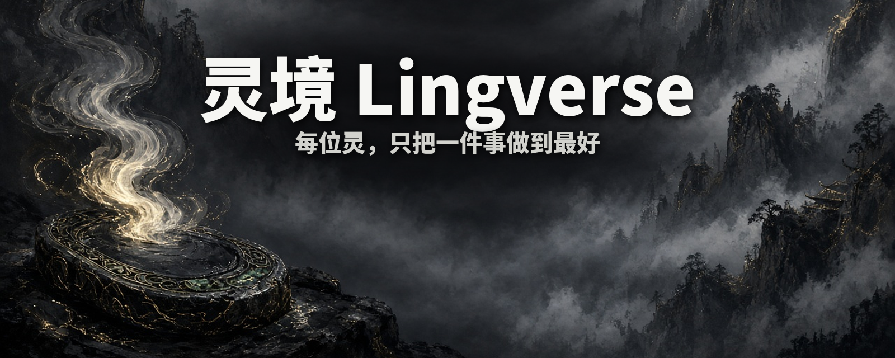

<p align="center"></p>

<h1 align="center">灵境 Lingverse</h1>

<p align="center"><b>一组能直接装进 Grok Bot 的「灵」，每位只把一件事做到最好。</b></p>

<p align="center">
  <a href="CHANGELOG.md"></a>
  <a href="LICENSE"></a>
  <a href="https://github.com/lingverse-ai/lingverse/actions/workflows/ci.yml"></a>
</p>

<p align="center"><a href="#english">English</a> · <a href="#墨灵--moling">墨灵</a> · <a href="#安装">安装</a> · <a href="#路线图">路线图</a> · <a href="#常见问题">常见问题</a></p>

---

## 灵境是什么

灵境是一个 Grok Bot 系列。每位「灵」都是一个可以分享、一键导入的 Bot，专管一件事：写长文、做 MV、看数据……灵之间共用同一套人设规范、安装方式和质量检查，但各自独立发版，装一位、不装另一位都可以。

第一位灵是 **墨灵**。

## 墨灵 · Moling

> 把你亲手干过的事，写成别人愿意收藏的长文，再改成每个平台各自的版本。

**写给谁：** 需要流量的项目操盘手和自媒体创业者。

**它做什么**

- **只做长文。** 不做短视频选题、口播脚本或分镜。
- **没有 AI 味。** 先从你的样稿里学你的口吻，改稿的唯一标准是「像不像你」。只用你自己的料：你的原话、你算过的账、你踩过的坑。不编任何数字和细节。
- **真正的爆款写法。** 选题只从你的真事里挑，用三把尺筛选：读者会点、会存、会转。标题用身份加大数字加具体结果、冲突对照等公式。开头要先过「读者能带走什么」这一关。每篇都配一个收藏件（表格、清单、提示词），文末给福利。
- **一稿六平台。** X Article、微信公众号（默认首发）、抖音长文、小红书、知乎专栏、微博头条，按各平台的读者和规则重写，不是复制粘贴。
- **守平台规矩。** 抖音、小红书、微博的版本零链接、零二维码、零站外导流；标题字数逐个核对；收益承诺、功效、极限词都会查。
- **只交文本。** 墨灵从不替你发布，最后一步永远由你来点。

**九个技能，一条流水线**

| # | 技能 | 做什么 |
|---|---|---|
| 1 | 入门对话 | 一次问一个问题，建立你的作者档案；支持「演练」模式，只打印不存 |
| 2 | 口吻学习 | 读你的样稿，整理出 12 项口吻档案，试写后让你打分校准 |
| 3 | 选题与标题 | 从你的真事里出选题，每次给 5 个标题并推荐 1 个，附各平台版本 |
| 4 | 结构与开头 | 清点真材料，按文章类型搭骨架，出 3～5 个开头 |
| 5 | 写初稿 | 只用核对过的材料写母版，写出真实感和共鸣，缺料就标出来问你 |
| 6 | 去 AI 味改稿 | 按 20 个特征逐句扫，用你自己的料深改 |
| 7 | 多平台改写 | 六个平台各写一版，清掉禁导流平台的链接和联系方式，查夸大 |
| 8 | 配图与封面 | 各平台的封面尺寸、安全区，收藏件做成图，出提示词 |
| 9 | 发布前自检 | 19 项检查，给出「可以发 / 改完再发」 |

另有两个后台技能：`moling-install` 负责安装，`moling-update` 负责更新。

## 安装

1. 打开墨灵的分享链接，导入到你的 Grok Bot（链接即将公布）。
2. 第一次对话时，墨灵会说明它要从本仓库装完整技能，大约一分钟，不装插件，也不要任何密钥。
3. 装好后直接开始入门对话。

**更新：** 对墨灵说一句「更新」。墨灵每周最多自动检查一次，有新版先用几行话告诉你改了什么，你同意才装。你的作者档案和口吻档案存在你自己的记忆里，更新不会覆盖。版本只发布打过标签、测试过的版本。

**入门前准备好这几样，十分钟就能开写**

- 你的身份和行业，你最想写给谁。
- 1～3 件你亲手干成或者踩过坑的事，最好带数字。
- 3～10 段你自己写的东西：文章、朋友圈、口播逐字稿、聊天记录都行。
- 你要发哪些平台，哪些内容不能写（比如收入、客户名字）。
- 文末想送读者什么。没有也行，墨灵按文章帮你设计。

## 示例

[`spirits/moling/examples/`](spirits/moling/examples/) 里是两位虚构主人的完整演练，从入门、口吻、选题、结构、初稿、深改、三平台改写、配图一直到发布前自检。全部是示例数据。

## 路线图

| 灵 | 职能 | 状态 |
|---|---|---|
| 墨灵 Moling | 长文 | ✅ v0.1.0 |
| 流萤 Ember | MV | 筹备中 |
| 朱砂 Cinnabar | 海报 | 筹备中 |
| 听潮 Tide | 声音 | 筹备中 |
| 算盘子 Abacus | 成交（XY Skill） | 筹备中 |
| 问樵 Sage | 战略 | 筹备中 |
| 守夜 Nightwatch | 雷达与复盘 | 筹备中 |

## 常见问题

**会不会写出 AI 味？** 墨灵的整套流程就是围着这件事设计的：学你的口吻、只用你的料、逐句扫 20 个 AI 特征、深改时补上只有你会说的话，发布前再扫一遍。

**会编数据吗？** 不会。每个数字都要能对上你给过的材料；推算出来的数会标出算式让你确认；对不上的就问你，或者删掉。

**能帮我直接发出去吗？** 不能，这是刻意设计的。墨灵只交文本，最多在你同意并登录后帮你存草稿，发布永远由你来点。

**抖音、小红书的版本为什么没有链接？** 这几个平台不允许站外导流。墨灵会把福利直接做进正文或图片里，读者在平台内就能拿到。

**要装插件或者给密钥吗？** 不用。

**仓库连不上怎么办？** 墨灵会先陪你做完入门，下次对话再装。

## 参与开发

```bash
python3 tools/validate.py                  # 格式、大小、交叉引用、隐私、平台数字一致
python3 tools/pack.py moling               # 生成 dist/ 配方
python3 spirits/moling/tests/run_tests.py  # 夹具和反向用例
```

只用 Python 3 标准库。规则见 [CONTRIBUTING.md](CONTRIBUTING.md)，结构如下：

```
shared/            所有灵共用的人设规范和安装技能写法
tools/             检查、打包、稿件机械检查
spirits/moling/    墨灵：skills/ · examples/ · tests/ · dist/
assets/            图片素材
```

## 许可

版权所有 © 2026 小爷。双许可，详见 [LICENSE](LICENSE)：

- **内容**（技能、示例、资料卡、记忆、shared/ 和所有文档）：[CC BY 4.0](https://creativecommons.org/licenses/by/4.0/)。转载或改编请署名「灵境 Lingverse · 小爷」，并附仓库链接。
- **工具代码**（tools/、tests/、.github/）：MIT。

---

## English

**Lingverse** is a family of shareable Grok Bots called *spirits*. Each spirit does one job well and ships on its own versioned tag.

**Moling**, the first spirit, is a long-form writer for project operators and self-media founders who need traffic. It learns your voice from your own samples and writes only from your real experiences and numbers, so the result reads like you, with no AI flavour. It aims for viral, bookmark-worthy pieces: topics from your own story, proven title patterns, an opening gate, and a saveable asset in every post. Each piece is then rewritten for six platforms: X Article, WeChat Official Accounts (the default), Douyin, Xiaohongshu, Zhihu and Weibo. Douyin, Xiaohongshu and Weibo versions carry no links and no off-platform calls to action. Moling hands you text only and never publishes for you.

- **Install:** import Moling from its share link (coming soon). On first chat it installs its full skill set from a pinned tag of this repo. No plugins, no keys.
- **Update:** say 「更新」 ("update"). Moling checks at most weekly, summarises what changed, and installs only after you say yes. Your profiles are never overwritten.
- **Skills:** onboarding, voice profile, topic and title, structure and opening, first draft, de-AI edit, multi-platform rewrite, covers and images, and a pre-publish check, plus install and update.
- **Roadmap:** 墨灵 Moling, long-form (✅ v0.1.0); 流萤 Ember, MV; 朱砂 Cinnabar, posters; 听潮 Tide, voice; 算盘子 Abacus, closing deals (XY Skill); 问樵 Sage, strategy; 守夜 Nightwatch, radar and review.
- **License:** © 2026 小爷. Content and skills under CC BY 4.0; tooling (`tools/`, `tests/`, `.github/`) under MIT.
